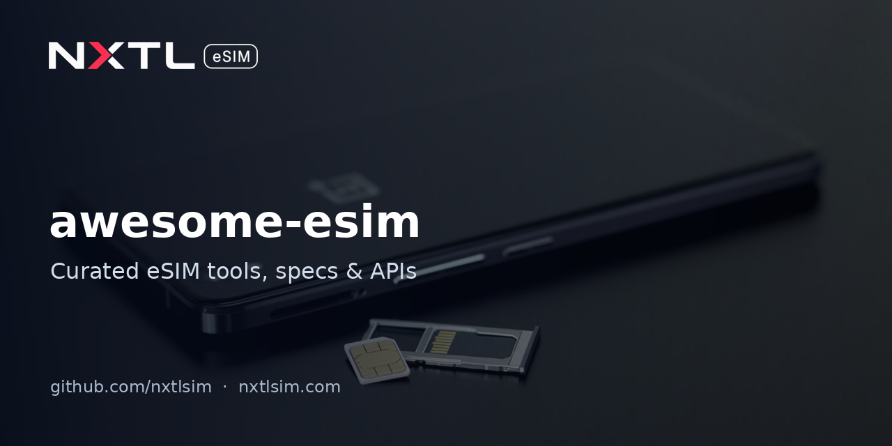

# Awesome eSIM 

> A curated list of open-source tools, specifications, developer APIs and practical resources for eSIM (embedded SIM): consumer, travel and IoT.

eSIM lets a device download a mobile operator profile instead of using a plastic SIM. This list collects what developers, tinkerers, travellers and fleet operators actually use: LPA tools, the GSMA specs behind them, device guides, provider APIs and connectivity tooling.

## Contents

- [Open-source tools](#open-source-tools)
- [Specifications and standards](#specifications-and-standards)
- [Device compatibility and setup](#device-compatibility-and-setup)
- [Guides](#guides)
- [Provider APIs and SDKs](#provider-apis-and-sdks)
- [Connectivity tools](#connectivity-tools)
- [Free tools](#free-tools)
- [MCP servers](#mcp-servers)
- [Comparison sites](#comparison-sites)
- [Related lists](#related-lists)

## Open-source tools

- [lpac](https://github.com/estkme-group/lpac) - C-based eUICC Local Profile Agent (LPA) for managing eSIM profiles.
- [EasyLPAC](https://github.com/creamlike1024/EasyLPAC) - Desktop GUI for lpac.
- [MiniLPA](https://github.com/EsimMoe/MiniLPA) - Desktop LPA user interface for managing eSIM profiles.
- [NekokoLPA](https://github.com/iebb/NekokoLPA) - Open-source LPA app for Android and iOS.
- [OpenEUICC](https://gitea.angry.im/PeterCxy/OpenEUICC) - Open-source Android LPA app. [GitHub mirror (estkme-group)](https://github.com/estkme-group/openeuicc).
- [eSIM-Tools](https://github.com/Silentely/eSIM-Tools) - Tools for Giffgaff and Simyo users to convert a physical SIM to eSIM, change devices and generate QR codes.
- [SimAdmin](https://github.com/3899/SimAdmin) - SIM/eSIM, cellular, SMS and status management for Debian-based cellular CPEs, pocket Wi-Fi and soft routers.
- [pySim](https://github.com/osmocom/pysim) - Osmocom's Python tools to read, program and explore SIM/USIM/ISIM cards. [Upstream](https://gitea.osmocom.org/sim-card/pysim).
- [onomondo-uicc](https://github.com/onomondo/onomondo-uicc) - Software implementation of a SIM/UICC/USIM.

## Specifications and standards

- [GSMA eSIM Consumer and IoT Specifications](https://www.gsma.com/solutions-and-impact/technologies/esim/esim-specification/) - Index of all GSMA eSIM specifications.
- [SGP.22 v3.1](https://www.gsma.com/solutions-and-impact/technologies/esim/gsma_resources/sgp-22-v3-1/) - Consumer eSIM Remote SIM Provisioning (RSP) technical specification.
- [SGP.32 v1.2](https://www.gsma.com/solutions-and-impact/technologies/esim/gsma_resources/sgp-32-v1-2/) - eSIM IoT technical specification (the IoT architecture for constrained and headless devices).
- [GSMA eSIM overview](https://www.gsma.com/solutions-and-impact/technologies/esim/) - Industry overview, whitepapers and certification.
- [ETSI TS 102 221](https://www.etsi.org/deliver/etsi_ts/102200_102299/102221/) - UICC-terminal interface, the physical and logical base SIM standard.
- [3GPP](https://www.3gpp.org/) - Home of the USIM and mobile network specifications.
- [Android eSIM implementation](https://source.android.com/docs/core/connect/esim-overview) - AOSP documentation for the eUICC APIs and LPA integration.
- [Apple CTCellularPlanProvisioning](https://developer.apple.com/documentation/coretelephony/ctcellularplanprovisioning) - iOS API for carriers to install eSIM plans in-app.

## Device compatibility and setup

- [Set up eSIM on iPhone](https://support.apple.com/en-us/118669) - Apple's official setup guide.
- [eSIM carriers worldwide for iPhone](https://support.apple.com/en-us/101569) - Apple's list of operators that support eSIM.
- [Dual SIM on Google Pixel](https://support.google.com/pixelphone/answer/9449293) - Using a physical SIM plus an eSIM on Pixel.
- [NXTL eSIM compatible devices](https://nxtlsim.com/esim-compatible-devices/) - Phones, tablets and laptops that support eSIM, with how to check yours.
- [eSIM.me](https://esim.me/) - Removable eSIM card for adding eSIM to devices without a built-in eUICC.

## Guides

- [eSIM on Wikipedia](https://en.wikipedia.org/wiki/ESIM) - History, architecture and terminology.
- [OpenWrt mwan3 guide](https://openwrt.org/docs/guide-user/network/wan/multiwan/mwan3) - Multi-WAN load balancing and failover, e.g. with a cellular backup.

## Provider APIs and SDKs

- [Airalo Partner API docs](https://developers.partners.airalo.com/) - REST API for reselling Airalo eSIM packages.
  - [airalo-nodejs-sdk](https://github.com/Airalo/airalo-nodejs-sdk) - Official Node.js SDK.
  - [airalo-python-sdk](https://github.com/Airalo/airalo-python-sdk) - Official Python SDK.
  - [airalo-php-sdk](https://github.com/Airalo/airalo-php-sdk) - Official PHP SDK.
- [NXTL B2B API reference](https://nxtlsim.com/nxtl-api-reference/) - REST API for issuing reusable data eSIMs, a pooled balance, usage reporting, thresholds and HMAC-signed webhooks. [OpenAPI 3.1 document](https://nxtlsim.com/wp-content/plugins/nxtl-data-esim-v2/docs/nxtl-v1-openapi.json).
  - [NXTL open-source repos](https://github.com/nxtlsim) - Balance alerts, webhook starter and setup guides.

## Connectivity tools

- [LibreSpeed](https://github.com/librespeed/speedtest) - Self-hosted HTML5 speed test.
- [speedtest-cli](https://github.com/sivel/speedtest-cli) - Command-line interface for Speedtest.net.
- [speedtest-go](https://github.com/showwin/speedtest-go) - Speedtest CLI and library in Go.
- [Cloudflare Speed Test](https://speed.cloudflare.com/) - Browser speed test with latency, jitter and packet-loss details.
- [mwan3](https://github.com/openwrt/packages/tree/master/net/mwan3) - OpenWrt multi-WAN manager for failover to a cellular line.

## Free tools

- [travel-connection-check](https://github.com/nxtlsim/travel-connection-check) - Browser speed, latency and packet-loss test that shows how much data each test uses.
- [trip-data-budget](https://github.com/nxtlsim/trip-data-budget) - Estimates mobile data needed for a trip from daily usage habits.
- [esim-compatibility-check](https://github.com/nxtlsim/esim-compatibility-check) - Checks whether a phone, tablet or laptop model supports eSIM, including model-code lookup.
- [team-data-planner](https://github.com/nxtlsim/team-data-planner) - Plans mobile data needs for a group or team across travellers and days.
- [nxtl-balance-alerts](https://github.com/nxtlsim/nxtl-balance-alerts) - Telegram, Slack or email alerts before an NXTL Business eSIM balance runs low (Python script or GitHub Action).
- [nxtl-webhook-starter](https://github.com/nxtlsim/nxtl-webhook-starter) - Webhook receiver that verifies HMAC signatures and forwards events to Slack (FastAPI or Cloudflare Worker).
- [esim-iot-backup-guides](https://github.com/nxtlsim/esim-iot-backup-guides) - Router failover and laptop backup-data setups with a travel eSIM.

## MCP servers

Model Context Protocol servers that let AI assistants query eSIM providers.

- [voidmob-mcp](https://github.com/voidmobcom/voidmob-mcp) - MCP server giving AI agents phone numbers, mobile proxies and travel eSIMs from VoidMob.
- [roamzy-io/mcp-server](https://github.com/roamzy-io/mcp-server) - MCP server for buying Roamzy global eSIMs from an AI agent.
- [esimagent-mcp](https://github.com/vladkomudrich/esimagent-mcp) - MCP server for eSIM Agent: search plans, compare providers and check device compatibility.

## Comparison sites

- [eSIMDB](https://esimdb.com/) - Searchable database of eSIM data plans by country.
- [MyBestSIM](https://www.mybestsim.com/) - eSIM plan comparison.
- [eSIMradar](https://esimradar.com/) - eSIM provider and plan comparison.
- [eSIM Sherpa](https://esimsherpa.com/) - Reviews and provider alternatives.
- [eSIM Podium](https://www.esimpodium.com/) - Comparison of one-off eSIM data plans.

## Related lists

- [awesome-mcp-servers](https://github.com/punkpeye/awesome-mcp-servers)
- [awesome-digital-nomads](https://github.com/cbovis/awesome-digital-nomads)
- [awesome-travel](https://github.com/unseen1980/awesome-travel)
- [GitHub topic: esim](https://github.com/topics/esim)

## Contributing

Contributions welcome! Read the [contribution guidelines](CONTRIBUTING.md) first.

---

**Disclosure:** this list is maintained by [NXTL eSIM](https://nxtlsim.com), an eSIM provider. NXTL's own resources are included alongside other providers' and are marked by name. Entries from any provider are accepted on the same terms. Inclusion is not an endorsement, and we do not accept payment for listings.

## License

Released under the [MIT License](LICENSE).
